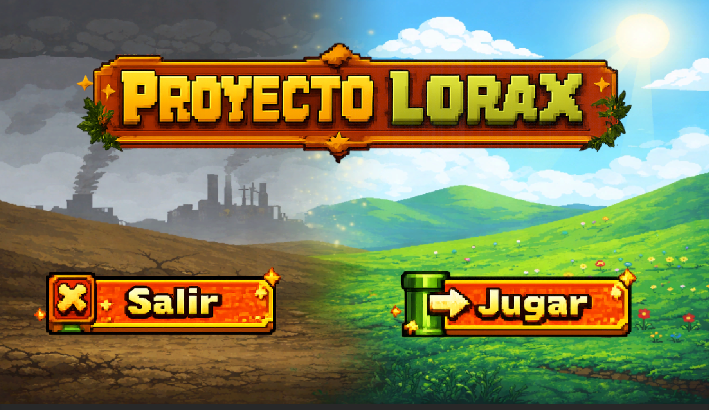
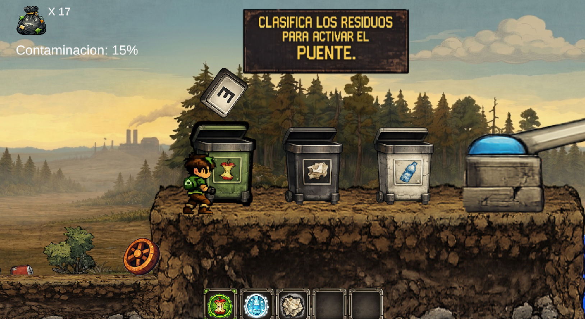
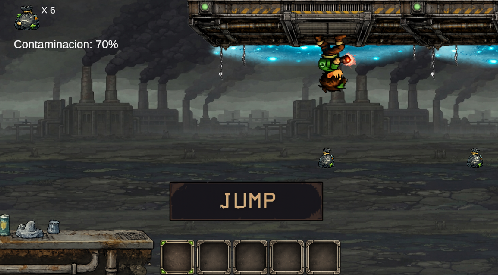
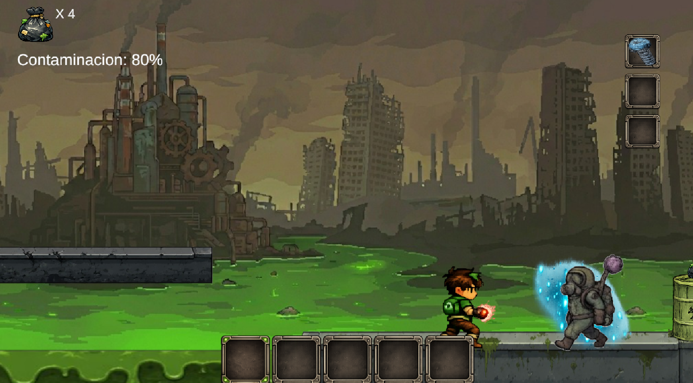

#  Proyecto Lorax
 
Videojuego 2D educativo desarrollado en **Unity 2022.3.62f3** con **C#**, creado como proyecto universitario durante el semestre **2026-1**.
 
Proyecto Lorax fue diseñado para que los niños pequeños se familiaricen, de forma divertida e interactiva, con el cuidado del medio ambiente. A través de tres niveles cortos, el jugador enfrenta distintos retos ambientales mientras aprende sobre buenas prácticas ecológicas.
 
##  Descripción del juego
 
El juego cuenta con **tres niveles**, cada uno centrado en una temática ambiental distinta:
 
1. **Nivel 1 — Clasificación de residuos:** el jugador debe separar correctamente los diferentes tipos de basura.
2. **Nivel 2 — Eficiencia energética:** el jugador aprende y aplica conceptos de ahorro y uso responsable de la energía.
3. **Nivel 3 — Contaminación del agua:** el jugador enfrenta retos relacionados con el cuidado de las fuentes hídricas.
###  Mecánica principal: Magnetismo (cargas positivas y negativas)
 
El personaje principal cuenta con poderes de **cargas positivas y negativas**, que funcionan como su mecánica central de combate y defensa:
 
- Si el personaje **ataca o es atacado con la carga opuesta**, el ataque **elimina** al objetivo.
- Si el personaje **ataca o es atacado con la misma carga**, el ataque **se repele** sin causar daño.
Esta mecánica obliga al jugador a identificar la carga de cada enemigo y elegir la polaridad correcta antes de actuar.
 
##  Imágenes del juego
 
| Menú principal | Nivel 1 — Residuos |
|:---:|:---:|
|  |  |
 
| Nivel 2 — Energía | Nivel 3 — Agua |
|:---:|:---:|
|  |  |
 

 
##  Tecnologías utilizadas
 
- **Motor:** Unity 2022.3.62f3
- **Lenguaje:** C#
- **Tipo de proyecto:** Videojuego 2D
- **Contexto:** Proyecto académico universitario (semestre 2026-1)

 ##  Cómo ejecutar el proyecto

### Requisitos previos

- [Unity Hub](https://unity.com/download) instalado
- Unity Editor **2022.3.62f3** (o una versión compatible de la serie 2022 LTS)
- Git instalado en tu equipo

### Pasos

1. Clona el repositorio:
```bash
   git clone https://github.com/alejandrocastalondo-source/Proyecto-Lorax.git
```
2. Abre **Unity Hub** → pestaña **Projects** → **Add** → selecciona la carpeta `Proyecto-Lorax` que acabas de clonar.
3. Si no tienes instalada la versión 2022.3.62f3, Unity Hub te lo indicará y te permitirá instalarla desde ahí mismo.
4. Abre el proyecto haciendo click en él dentro de Unity Hub. La primera vez puede tardar unos minutos mientras Unity importa todos los assets.
5. En la ventana **Project**, dentro de `Assets/Scenes/`, abre la escena del **MainMenu** (doble clic sobre ella).
6. Presiona el botón **Play** en la parte superior del editor para ejecutar el juego.

##  Estructura del proyecto

```
Proyecto-Lorax/
├── Assets/              # Escenas, scripts, sprites, prefabs, audio y demás assets del juego
├── Packages/            # Dependencias gestionadas por el Unity Package Manager
├── ProjectSettings/     # Configuración del proyecto (input, física, calidad gráfica, etc.)
├── screenshots/         # Capturas de pantalla usadas en este README
├── .gitignore           # Archivos y carpetas excluidos del control de versiones
├── .vsconfig            # Configuración del editor de código (Visual Studio)
└── README.md            # Este archivo
```
##  Inspiración y aclaración
 
Este proyecto toma una **leve inspiración** del universo de la película *El Lorax* únicamente como referencia estética y temática para transmitir un mensaje de conciencia ambiental a los niños.
 
**Proyecto Lorax es un trabajo académico, sin fines de lucro, y en ningún momento tuvo la intención de plagiar, copiar o apropiarse de la obra original, sus personajes, su historia o cualquier otro elemento protegido.** Todo el contenido del juego (arte, código, niveles y mecánicas) fue creado por el equipo de desarrollo con fines exclusivamente educativos.
 
##  Autor
 
- Daniel Castañeda Londoño https://github.com/alejandrocastalondo-source
##  Coautores
 
- Paola Andrea Carmona Salazar https://github.com/paolaandrea3883-blip
- Alejandro Lopez Dominguez https://github.com/Parzival0772
- Nicolas Martinez Cardona https://github.com/Nico752-M
- Isabella Serna Torres https://github.com/IsabellaSernaT
## ⚠️ Aviso de uso
 
Este repositorio se publica **sin licencia**. Esto significa que, por defecto, **todos los derechos quedan reservados a los autores**. No está permitido:
 
- Copiar, reproducir o distribuir este proyecto (total o parcialmente) sin autorización.
- Utilizar el código, los assets o las mecánicas con fines comerciales o académicos ajenos sin el consentimiento explícito de los autores.
- Apropiarse del trabajo aquí presentado y presentarlo como propio.
Si deseas usar este proyecto como referencia o inspiración, por favor contacta primero a los autores.
